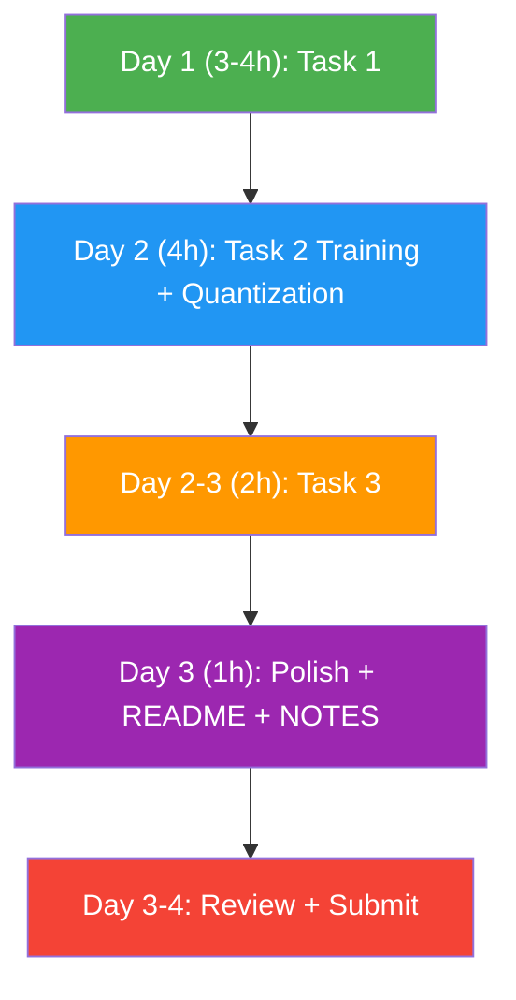

# KavachX AI/ML Technical Assessment — Implementation Plan

> **Deadline:** 4 days (Tuesday) · **Effort:** 6–10 hours · **Python:** 3.10+

---

## Table of Contents

1. [Project Overview](#1-project-overview)
2. [Repository Setup](#2-repository-setup)
3. [Task 1 — Plain-English Rule → Event JSON](#3-task-1--plain-english-rule--event-json)
4. [Task 2 — Train, Quantize & Fit Edge Budget](#4-task-2--train-quantize--fit-edge-budget)
5. [Task 3 — Cascaded False-Positive Verifier](#5-task-3--cascaded-false-positive-verifier)
6. [Submission Prep & Final Checklist](#6-submission-prep--final-checklist)

---

## 1. Project Overview

KavachX turns existing CCTV cameras into AI-powered safety surveillance. The assessment has **three real-world tasks**:

| Task | Core Problem | Key Deliverables | Time |
|------|-------------|-----------------|------|
| **Task 1** | Parse natural-language rules → detect objects → track & emit JSON events | `task1/rule_engine.py`, sample JSON, masked frames | 3–4 h |
| **Task 2** | Train YOLOv8n for PPE detection, quantize to INT8, add motion gating | Training notebook, quantization pipeline, benchmark table | 4 h |
| **Task 3** | Build a second-stage verifier to filter false alarms | `task3/verifier.py`, precision/recall metrics, cost analysis | 2 h |

---

## 2. Repository Setup

### 2.1 Directory Structure

```
kavachx-assessment/
├── README.md                    # Setup instructions & run commands
├── NOTES.md                     # Design choices, AI usage, trade-offs
├── requirements.txt             # Pinned dependencies
├── event_schema.json            # Provided event schema
├── zones.json                   # Provided zone polygon
│
├── clips/
│   ├── loading_bay.mp4          # Task 1 video
│   └── static_heavy.mp4         # Task 2 motion gating video
│
├── data/
│   └── ppe/                     # ~300 CCTV frames in YOLO format
│       ├── train/               # 240 images + labels
│       └── val/                 # 60 images + labels
│
├── alerts/                      # 30 nighttime intrusion snapshots
│   └── labels.csv               # Ground truth (true/false alarm)
│
├── task1/
│   ├── rule_parser.py           # NLP rule → structured config
│   ├── detector.py              # Open-vocabulary detection
│   ├── tracker.py               # Tracking + dwell time
│   ├── privacy.py               # Face/head blurring
│   ├── event_emitter.py         # JSON event generation
│   ├── run_task1.py             # Main orchestrator
│   └── outputs/                 # Generated events & masked frames
│
├── task2/
│   ├── train.py                 # Training script (or Colab notebook)
│   ├── train_notebook.ipynb     # Google Colab training notebook
│   ├── quantize_pipeline.py     # ONNX export + FP32/FP16/INT8
│   ├── benchmark.py             # Latency & mAP comparison
│   ├── motion_gate.py           # Motion gating simulation
│   ├── evaluate.py              # mAP@50, per-class recall, failure cases
│   └── outputs/                 # Weights, logs, plots, benchmark table
│
├── task3/
│   ├── verifier.py              # CLIP/VLM-based false positive filter
│   ├── evaluate.py              # Precision/recall comparison
│   └── outputs/                 # Metrics, threshold analysis
│
└── utils/
    ├── video_utils.py           # Frame extraction, FPS helpers
    └── geometry.py              # Point-in-polygon, zone checks
```

### 2.2 Step-by-Step Environment Setup

```bash
# 1. Create project directory
mkdir kavachx-assessment && cd kavachx-assessment

# 2. Create virtual environment
python3.10 -m venv venv
source venv/bin/activate

# 3. Install dependencies (create requirements.txt first — see §2.3)
pip install -r requirements.txt

# 4. Create all directories
mkdir -p clips data/ppe/train data/ppe/val alerts \
         task1/outputs task2/outputs task3/outputs utils

# 5. Copy provided assets into the right folders
# - loading_bay.mp4, static_heavy.mp4 → clips/
# - PPE dataset → data/ppe/
# - Alert snapshots + labels.csv → alerts/
# - zones.json, event_schema.json → root
```

### 2.3 `requirements.txt` (Pinned)

```txt
# Core
ultralytics==8.3.40
opencv-python-headless==4.10.0.84
numpy==1.26.4
Pillow==10.4.0

# Open-vocab detection
# Option A: YOLO-World (bundled in ultralytics)
# Option B: OWL-ViT
transformers==4.45.2
torch==2.4.1
torchvision==0.19.1

# Tracking
supervision==0.25.0       # ByteTrack integration, annotations
lap==0.5.12               # Linear assignment for tracking

# Rule parsing (LLM)
openai==1.51.0            # Or use google-generativeai for Gemini
# google-generativeai==0.8.3

# CLIP (Task 3)
open-clip-torch==2.26.1

# Quantization
onnx==1.17.0
onnxruntime==1.19.2
onnxruntime-extensions==0.12.0

# Utilities
shapely==2.0.6            # Polygon geometry
tqdm==4.66.5
pandas==2.2.3
matplotlib==3.9.2
```

---

## 3. Task 1 — Plain-English Rule → Event JSON

**Goal:** Given a natural language rule and a video, detect rule violations and emit structured JSON events.

### 3.1 Step 1: Rule Parser (`task1/rule_parser.py`)

**What it does:** Converts `"Alert me if a person carrying a bag enters the loading bay and stays more than 10 seconds"` into a structured config.

**Implementation:**

```python
# Approach: Use an LLM (OpenAI/Gemini) with a structured output prompt
# Input: plain English rule string
# Output: dict with keys: target_class, attributes, zone, dwell_threshold_s

# Prompt template:
SYSTEM_PROMPT = """
You are a rule parser for a video surveillance system.
Given a plain-English monitoring rule, extract:
- target_class: the object to detect (e.g., "person")
- attributes: dict of visual attributes to check (e.g., {"carrying": "bag"})
- zone: the named zone the object must be in (e.g., "loading_bay")
- dwell_threshold_s: minimum seconds the target must stay (float)
- rule_id: a snake_case identifier for this rule

Return ONLY valid JSON matching this schema. No explanation.
"""
```

**Steps:**
1. Define the system prompt with extraction instructions
2. Call the LLM API with the user's rule text
3. Parse the JSON response
4. Validate required fields exist
5. Return a `RuleConfig` dataclass

> [!TIP]
> **Fallback approach** (if no API key): Use regex + spaCy NER to extract entities. This is acceptable as a lighter alternative — document this choice in `NOTES.md`.

---

### 3.2 Step 2: Open-Vocabulary Detection (`task1/detector.py`)

**What it does:** Detects arbitrary objects without retraining using open-vocab models.

**Implementation Options (choose one):**

| Option | Pros | Cons |
|--------|------|------|
| **YOLO-World (Recommended)** | Fast, easy via Ultralytics API, good accuracy | Newer model |
| OWL-ViT | Good zero-shot | Slower, HuggingFace dependency |
| CLIP crop scoring | Flexible | Requires object proposals first |

**Steps with YOLO-World:**
1. Load `yolov8s-worldv2` model via Ultralytics
2. Set custom classes from the parsed rule (e.g., `["person", "bag"]`)
3. Run inference on each video frame
4. Return bounding boxes, classes, and confidence scores
5. For attribute detection (e.g., "carrying a bag"):
   - Detect both "person" and "bag" 
   - Check spatial overlap/proximity: if a bag bbox overlaps ≥50% with a person bbox, mark `carrying: bag`

```python
from ultralytics import YOLO

model = YOLO("yolov8s-worldv2.pt")
model.set_classes(["person", "bag"])  # Dynamic from parsed rule

results = model.predict(frame, conf=0.3)
```

---

### 3.3 Step 3: Tracking & Dwell Time (`task1/tracker.py`)

**What it does:** Tracks detected persons across frames and measures how long they stay inside a polygon zone.

**Implementation:**
1. Use **ByteTrack** (via `supervision` library) for multi-object tracking
2. For each tracked object:
   - Compute the bottom-center point of the bounding box (foot position)
   - Use Shapely's `Point.within(Polygon)` to check zone containment
   - Accumulate dwell time: `dwell_s += 1 / fps` for each frame the track is inside the zone
3. When `dwell_s >= threshold`, flag as a violation
4. Store `ts_start` (first frame entering zone) and `ts_end` (violation trigger time)

```python
from shapely.geometry import Point, Polygon
import supervision as sv

tracker = sv.ByteTrack()
zone_polygon = Polygon(zones_json["loading_bay"])

# Per-frame loop:
#   detections = detector.detect(frame)
#   tracked = tracker.update_with_detections(detections)
#   for track_id, bbox in tracked:
#       foot_point = Point(center_x, bbox_bottom_y)
#       if zone_polygon.contains(foot_point):
#           dwell_tracker[track_id] += 1/fps
```

---

### 3.4 Step 4: Privacy Protection (`task1/privacy.py`)

**What it does:** Blurs faces/heads in the evidence frame.

**Implementation:**
1. Use a **face detection** model (e.g., `cv2.CascadeClassifier` or MediaPipe Face Detection)
2. For each detected face, apply Gaussian blur to that region
3. Additionally, blur the upper ~30% of each person bbox (head region) as a safety net
4. Return the privacy-protected frame

```python
import cv2

def blur_faces(frame, person_bboxes):
    # Method 1: OpenCV Haar Cascade for face detection
    face_cascade = cv2.CascadeClassifier(
        cv2.data.haarcascades + 'haarcascade_frontalface_default.xml'
    )
    gray = cv2.cvtColor(frame, cv2.COLOR_BGR2GRAY)
    faces = face_cascade.detectMultiScale(gray, 1.1, 4)
    
    for (x, y, w, h) in faces:
        frame[y:y+h, x:x+w] = cv2.GaussianBlur(
            frame[y:y+h, x:x+w], (99, 99), 30
        )
    
    # Method 2: Blur head region of each person bbox as fallback
    for bbox in person_bboxes:
        x1, y1, x2, y2 = bbox
        head_h = int((y2 - y1) * 0.3)
        frame[y1:y1+head_h, x1:x2] = cv2.GaussianBlur(
            frame[y1:y1+head_h, x1:x2], (99, 99), 30
        )
    return frame
```

---

### 3.5 Step 5: Event Emission (`task1/event_emitter.py`)

**What it does:** Creates the final JSON event matching `event_schema.json`.

**Steps:**
1. Generate a UUID for `event_id`
2. Fill in device/camera IDs (hardcoded as `kx-edge-001`, `cam-03`)
3. Encode the privacy-protected evidence frame as base64 JPEG
4. Set `needs_verification = True` when confidence < 0.6 (configurable threshold)
5. Write JSON to `task1/outputs/`

---

### 3.6 Step 6: Main Orchestrator (`task1/run_task1.py`)

```python
# Pseudocode flow:
def main(rule_text, video_path, zones_path):
    # 1. Parse rule
    config = parse_rule(rule_text)
    
    # 2. Load zone polygon
    zone = load_zone(zones_path, config.zone)
    
    # 3. Initialize detector + tracker
    detector = OpenVocabDetector(config.target_class, config.attributes)
    tracker = DwellTracker(zone, config.dwell_threshold_s)
    
    # 4. Process video frame by frame
    cap = cv2.VideoCapture(video_path)
    fps = cap.get(cv2.CAP_PROP_FPS)
    
    events = []
    while cap.isOpened():
        ret, frame = cap.read()
        if not ret: break
        
        detections = detector.detect(frame)
        tracks = tracker.update(detections, fps)
        
        for violation in tracker.get_violations():
            masked_frame = blur_faces(frame, violation.person_bboxes)
            event = emit_event(config, violation, masked_frame)
            events.append(event)
    
    # 5. Save outputs
    save_events(events, "task1/outputs/")
    save_masked_frames(events, "task1/outputs/")
```

### 3.7 Deliverables Checklist — Task 1

- [ ] `rule_parser.py` — LLM-based or NLP-based parser (no hardcoding)
- [ ] `detector.py` — Open-vocab detection (YOLO-World preferred)
- [ ] `tracker.py` — ByteTrack + dwell time logic
- [ ] `privacy.py` — Face/head blurring
- [ ] `event_emitter.py` — JSON event matching schema
- [ ] `run_task1.py` — End-to-end orchestrator
- [ ] `outputs/` — Sample JSON event + 2–3 masked frames

---

## 4. Task 2 — Train, Quantize & Fit Edge Budget

### 4.1 Step 1: Training on Google Colab (`task2/train_notebook.ipynb`)

**Setup on Colab:**
```python
# Cell 1: Install dependencies
!pip install ultralytics==8.3.40

# Cell 2: Upload/mount dataset
# Option A: Google Drive mount
from google.colab import drive
drive.mount('/content/drive')

# Option B: Upload zip
# !unzip ppe_dataset.zip -d /content/data/
```

**Data Augmentation Strategy (document in NOTES.md):**

| Augmentation | Reason for CCTV |
|-------------|-----------------|
| `mosaic=1.0` | Handles multiple workers in frame |
| `mixup=0.1` | Improves generalization |
| `hsv_h=0.015, hsv_s=0.5, hsv_v=0.3` | Handles varying lighting conditions |
| `degrees=5.0` | CCTV cameras have slight rotations |
| `translate=0.1` | Objects at varying positions |
| `scale=0.3` | Workers at different distances |
| `perspective=0.0005` | CCTV perspective distortion |
| `flipud=0.0` | **Disabled** — people don't appear upside down |
| `fliplr=0.5` | Left/right symmetry is valid |

**Training Command:**
```python
from ultralytics import YOLO

model = YOLO("yolov8n.pt")  # Start from COCO pretrained weights

results = model.train(
    data="/content/data/ppe/data.yaml",  # dataset config
    imgsz=416,
    epochs=15,
    batch=16,
    device=0,              # GPU
    name="ppe_yolov8n",
    # Augmentation config
    mosaic=1.0,
    mixup=0.1,
    hsv_h=0.015,
    hsv_s=0.5,
    hsv_v=0.3,
    degrees=5.0,
    translate=0.1,
    scale=0.3,
    perspective=0.0005,
    flipud=0.0,
    fliplr=0.5,
)
```

**`data.yaml` for the dataset:**
```yaml
path: /content/data/ppe
train: train/images
val: val/images

nc: 2
names:
  0: helmet
  1: no_helmet
```

---

### 4.2 Step 2: Evaluate Baseline (`task2/evaluate.py`)

**Steps:**
1. Run validation after training:
   ```python
   metrics = model.val(data="data.yaml", imgsz=416)
   print(f"mAP@50: {metrics.box.map50:.4f}")
   print(f"Per-class recall: {metrics.box.r}")
   ```
2. Report **mAP@50** and **per-class recall** (helmet, no_helmet)
3. **Document 5 failure cases** — manually inspect validation predictions:
   ```python
   results = model.predict(source="data/ppe/val/images", save=True, conf=0.25)
   # Visually inspect and find 5 failure cases
   ```

**Common failure patterns to look for:**
- Small/distant `no_helmet` heads
- Partially occluded workers
- Unusual lighting / shadows on helmets
- Helmet-like objects (hard hats in background)
- Workers at extreme camera angles

---

### 4.3 Step 3: Quantization Pipeline (`task2/quantize_pipeline.py`)

> [!IMPORTANT]
> This must be an **automated pipeline script** — not manual steps.

```python
"""
Automated Model Quantization Pipeline
Input: best.pt (trained YOLOv8n weights)
Output: FP32, FP16, INT8 ONNX models
"""

import os
import glob
import numpy as np
from ultralytics import YOLO
import onnxruntime as ort
from onnxruntime.quantization import (
    quantize_static,
    CalibrationDataReader,
    QuantType,
    QuantFormat,
)

# ========== STEP 1: Export to ONNX (FP32) ==========
def export_to_onnx(weights_path, imgsz=416):
    model = YOLO(weights_path)
    # FP32 export
    fp32_path = model.export(format="onnx", imgsz=imgsz, half=False)
    # FP16 export
    fp16_path = model.export(format="onnx", imgsz=imgsz, half=True)
    return fp32_path, fp16_path

# ========== STEP 2: Calibration Data Reader for INT8 ==========
class PPECalibrationReader(CalibrationDataReader):
    """Reads ~100 calibration images for INT8 static quantization."""
    
    def __init__(self, calibration_dir, input_name, input_shape):
        self.image_paths = glob.glob(f"{calibration_dir}/*.jpg")[:100]
        self.input_name = input_name
        self.input_shape = input_shape  # (1, 3, 416, 416)
        self.index = 0
    
    def get_next(self):
        if self.index >= len(self.image_paths):
            return None
        img = preprocess_image(self.image_paths[self.index], self.input_shape)
        self.index += 1
        return {self.input_name: img}

# ========== STEP 3: INT8 Static Post-Training Quantization ==========
def quantize_to_int8(fp32_onnx_path, calibration_dir, output_path):
    # Get model input details
    session = ort.InferenceSession(fp32_onnx_path)
    input_name = session.get_inputs()[0].name
    input_shape = session.get_inputs()[0].shape
    
    calibration_reader = PPECalibrationReader(
        calibration_dir, input_name, input_shape
    )
    
    quantize_static(
        model_input=fp32_onnx_path,
        model_output=output_path,
        calibration_data_reader=calibration_reader,
        quant_format=QuantFormat.QDQ,
        weight_type=QuantType.QInt8,
        activation_type=QuantType.QUInt8,
    )
    return output_path

# ========== STEP 4: Run Full Pipeline ==========
def run_pipeline(weights_path, calibration_dir, output_dir):
    os.makedirs(output_dir, exist_ok=True)
    
    # Export FP32 & FP16
    fp32_path, fp16_path = export_to_onnx(weights_path)
    
    # Quantize to INT8
    int8_path = os.path.join(output_dir, "best_int8.onnx")
    quantize_to_int8(fp32_path, calibration_dir, int8_path)
    
    print("Pipeline complete!")
    print(f"  FP32: {fp32_path} ({os.path.getsize(fp32_path)/1e6:.1f} MB)")
    print(f"  FP16: {fp16_path} ({os.path.getsize(fp16_path)/1e6:.1f} MB)")
    print(f"  INT8: {int8_path} ({os.path.getsize(int8_path)/1e6:.1f} MB)")
```

---

### 4.4 Step 4: Benchmark Comparison (`task2/benchmark.py`)

**Measure for each variant:**
1. **File Size** — `os.path.getsize()`
2. **CPU Latency** — average inference time over 50 frames on CPU
3. **mAP@50** — run validation with each ONNX variant
4. **no_helmet Recall** — per-class recall

```python
import time
import onnxruntime as ort

def benchmark_model(onnx_path, val_images, num_runs=50):
    session = ort.InferenceSession(onnx_path, providers=["CPUExecutionProvider"])
    
    # Warmup
    for _ in range(5):
        session.run(None, {input_name: dummy_input})
    
    # Timed runs
    times = []
    for img in val_images[:num_runs]:
        start = time.perf_counter()
        session.run(None, {input_name: preprocess(img)})
        times.append((time.perf_counter() - start) * 1000)
    
    return {
        "size_mb": os.path.getsize(onnx_path) / 1e6,
        "latency_ms": np.mean(times),
        "latency_std": np.std(times),
    }
```

**Benchmark Table to fill:**

| Model Variant | Size (MB) | CPU Latency (ms) | mAP@50 | no_helmet Recall |
|---------------|-----------|-------------------|--------|------------------|
| FP32 ONNX     | —         | —                 | —      | —                |
| FP16 ONNX     | —         | —                 | —      | —                |
| INT8 ONNX     | —         | —                 | —      | —                |
| INT8 + Motion Gate | —    | —                 | —      | —                |

> [!WARNING]
> **If INT8 drops > 2 mAP points vs FP32**, try one mitigation:
> - **Option A:** Use QAT (Quantization-Aware Training) instead of PTQ
> - **Option B:** Increase calibration images to 200+
> - **Option C:** Use mixed-precision (keep certain layers in FP16)
> - Document which you tried and the results.

---

### 4.5 Step 5: Motion Gating Simulation (`task2/motion_gate.py`)

**Concept:** Only run the expensive detector when motion is detected, with periodic full-frame passes every N frames.

```python
import cv2

def compute_motion(prev_gray, curr_gray, threshold=25, min_area_ratio=0.005):
    """Returns True if significant motion is detected."""
    diff = cv2.absdiff(prev_gray, curr_gray)
    _, thresh = cv2.threshold(diff, threshold, 255, cv2.THRESH_BINARY)
    
    # Morphological operations to clean noise
    kernel = cv2.getStructuringElement(cv2.MORPH_ELLIPSE, (5, 5))
    thresh = cv2.morphologyEx(thresh, cv2.MORPH_OPEN, kernel)
    thresh = cv2.morphologyEx(thresh, cv2.MORPH_CLOSE, kernel)
    
    motion_area = cv2.countNonZero(thresh)
    total_area = curr_gray.shape[0] * curr_gray.shape[1]
    
    return (motion_area / total_area) > min_area_ratio

def run_with_motion_gate(video_path, model, full_frame_interval=30):
    cap = cv2.VideoCapture(video_path)
    prev_gray = None
    frame_count = 0
    detector_calls = 0
    total_frames = 0
    
    while cap.isOpened():
        ret, frame = cap.read()
        if not ret: break
        total_frames += 1
        
        gray = cv2.cvtColor(frame, cv2.COLOR_BGR2GRAY)
        gray = cv2.GaussianBlur(gray, (21, 21), 0)
        
        run_detector = False
        
        # Full-frame pass every N frames (safety net)
        if frame_count % full_frame_interval == 0:
            run_detector = True
        # Motion-triggered pass
        elif prev_gray is not None and compute_motion(prev_gray, gray):
            run_detector = True
        
        if run_detector:
            results = model(frame)
            detector_calls += 1
        
        prev_gray = gray
        frame_count += 1
    
    fps = cap.get(cv2.CAP_PROP_FPS)
    duration_s = total_frames / fps
    
    print(f"Without motion gate: {total_frames/duration_s:.1f} detector calls/sec")
    print(f"With motion gate:    {detector_calls/duration_s:.1f} detector calls/sec")
    print(f"Reduction: {(1 - detector_calls/total_frames)*100:.1f}%")
```

### 4.6 Deliverables Checklist — Task 2

- [ ] `train_notebook.ipynb` — Colab notebook with training code & results
- [ ] `quantize_pipeline.py` — Automated FP32 → FP16 → INT8 pipeline
- [ ] `benchmark.py` — Latency + accuracy comparison script
- [ ] `motion_gate.py` — Motion gating simulation
- [ ] `evaluate.py` — mAP@50, recall, 5 failure cases
- [ ] `outputs/` — Benchmark table, training plots, failure case images
- [ ] Weights link (Google Drive or similar)

---

## 5. Task 3 — Cascaded False-Positive Verifier

### 5.1 Step 1: Build Verifier (`task3/verifier.py`)

**Approach: Zero-Shot CLIP with engineered prompts**

```python
import open_clip
import torch
from PIL import Image

# Load CLIP model
model, _, preprocess = open_clip.create_model_and_transforms(
    "ViT-B-32", pretrained="laion2b_s34b_b79k"
)
tokenizer = open_clip.get_tokenizer("ViT-B-32")

# Engineered text prompts
POSITIVE_PROMPTS = [
    "a person trespassing at night captured by security camera",
    "an intruder breaking into a property at night",
    "a human figure moving suspiciously in a dark area",
    "nighttime security camera footage of unauthorized person",
    "a person climbing over a fence or wall at night",
]

NEGATIVE_PROMPTS = [
    "shadows and light patterns on an empty area at night",
    "rain falling in front of a security camera at night",
    "an animal such as a cat or dog moving at night",
    "wind blowing trees or debris at night on security camera",
    "empty scene with no people, just darkness and lighting",
    "camera noise or lens flare at night",
]

def score_alert(image_path):
    """Score an alert image. Returns intrusion probability [0, 1]."""
    image = preprocess(Image.open(image_path)).unsqueeze(0)
    
    pos_tokens = tokenizer(POSITIVE_PROMPTS)
    neg_tokens = tokenizer(NEGATIVE_PROMPTS)
    
    with torch.no_grad():
        image_features = model.encode_image(image)
        pos_features = model.encode_text(pos_tokens)
        neg_features = model.encode_text(neg_tokens)
        
        # Normalize
        image_features /= image_features.norm(dim=-1, keepdim=True)
        pos_features /= pos_features.norm(dim=-1, keepdim=True)
        neg_features /= neg_features.norm(dim=-1, keepdim=True)
        
        # Average similarity to positive vs negative prompts
        pos_sim = (image_features @ pos_features.T).mean().item()
        neg_sim = (image_features @ neg_features.T).mean().item()
        
        # Convert to probability
        score = pos_sim / (pos_sim + neg_sim + 1e-8)
    
    return score
```

---

### 5.2 Step 2: Evaluate Performance (`task3/evaluate.py`)

```python
import pandas as pd
from sklearn.metrics import precision_score, recall_score

# Load ground truth
labels = pd.read_csv("alerts/labels.csv")

# Score all alerts
labels["verifier_score"] = labels["image_path"].apply(score_alert)

# (a) Edge Model Alone — all 30 sent as alerts
#     Precision = true_intrusions / 30
#     Recall = 1.0 (all real intrusions are caught)

edge_precision = labels["is_intrusion"].sum() / len(labels)
edge_recall = 1.0

# (b) Edge + Verifier — apply threshold
def evaluate_at_threshold(df, threshold):
    predicted = df["verifier_score"] >= threshold
    tp = ((predicted == True) & (df["is_intrusion"] == True)).sum()
    fp = ((predicted == True) & (df["is_intrusion"] == False)).sum()
    fn = ((predicted == False) & (df["is_intrusion"] == True)).sum()
    
    precision = tp / (tp + fp) if (tp + fp) > 0 else 0
    recall = tp / (tp + fn) if (tp + fn) > 0 else 0
    return precision, recall

# Sweep thresholds to find optimal
thresholds = np.arange(0.3, 0.9, 0.05)
results = []
for t in thresholds:
    p, r = evaluate_at_threshold(labels, t)
    results.append({"threshold": t, "precision": p, "recall": r, "f1": 2*p*r/(p+r+1e-8)})

results_df = pd.DataFrame(results)
optimal = results_df.loc[results_df["f1"].idxmax()]
print(f"Optimal threshold: {optimal['threshold']:.2f}")
print(f"  Precision: {optimal['precision']:.3f}")
print(f"  Recall: {optimal['recall']:.3f}")
```

**Threshold Selection Rationale:**
- In security, **recall** matters more than precision (don't miss real intrusions)
- But too many false alarms cause "alert fatigue"
- Aim for recall ≥ 0.95 while maximizing precision
- Use F1 or F2-score (F2 weights recall 2× more) to find the sweet spot

---

### 5.3 Step 3: Economic & Product Analysis (NOTES.md section)

Write ~0.5 page covering:

#### Monthly API Cost Estimate

```
200 alerts/day × 30 days = 6,000 alerts/month

If using CLIP (local):
  - Cost = 0 (runs on edge or local server)
  - GPU compute: ~$0.50/hour × 0.5 hours/day = ~$15/month

If using a VLM API (e.g., GPT-4V):
  - ~$0.01 per image (low-res input)
  - 6,000 × $0.01 = ~$60/month
  - With batch API: ~$30/month

If using Claude Vision:
  - ~$0.005 per image
  - 6,000 × $0.005 = ~$30/month
```

#### "Flag as Incorrect" Feedback Loop

- Store flagged events in a feedback database with `(image, predicted_label, corrected_label)`
- **Short-term:** Adjust the confidence threshold per-site based on error rate
- **Medium-term:** Fine-tune CLIP or train a lightweight binary classifier on accumulated flagged data
- **Long-term:** Active learning pipeline — prioritize uncertain predictions for human review, continuously improving the model
- Include flag metadata (time of day, weather conditions) to detect systematic failure modes

### 5.4 Deliverables Checklist — Task 3

- [ ] `verifier.py` — CLIP-based secondary verifier
- [ ] `evaluate.py` — Precision/recall comparison (edge-only vs. edge+verifier)
- [ ] `outputs/` — Metrics table, threshold sweep plot
- [ ] NOTES.md section — Cost analysis + feedback loop design

---

## 6. Submission Prep & Final Checklist

### 6.1 `README.md` Structure

```markdown
# KavachX AI/ML Technical Assessment

## Quick Start
\```bash
python3.10 -m venv venv && source venv/bin/activate
pip install -r requirements.txt
\```

## Task 1: Rule-to-Event Pipeline
\```bash
python task1/run_task1.py \
    --rule "Alert me if a person carrying a bag enters the loading bay and stays more than 10 seconds" \
    --video clips/loading_bay.mp4 \
    --zones zones.json
\```

## Task 2: PPE Detection & Quantization
\```bash
# Training (run on Colab — see task2/train_notebook.ipynb)
# Quantization pipeline (run locally)
python task2/quantize_pipeline.py --weights task2/outputs/best.pt
# Benchmark
python task2/benchmark.py
# Motion gating
python task2/motion_gate.py --video clips/static_heavy.mp4
\```

## Task 3: False-Positive Verifier
\```bash
python task3/verifier.py --alerts-dir alerts/ --labels alerts/labels.csv
python task3/evaluate.py
\```
```

### 6.2 `NOTES.md` Structure

```markdown
# Design Notes

## Overall Architecture
- [Design philosophy and approach]

## Task 1 Notes
- Rule parser: chose [LLM/regex] because...
- Open-vocab detector: chose YOLO-World because...
- Tracking: ByteTrack with dwell accumulation
- Privacy: Dual approach (face detection + head region blur)

## Task 2 Notes
- Augmentation rationale (table with justification per augment)
- 5 failure cases with analysis
- Quantization: PTQ with 100 calibration images
- [If INT8 dropped >2 mAP] Mitigation attempted: ...

## Task 3 Notes
- CLIP prompt engineering strategy
- Threshold selection methodology
- Economic analysis (~0.5 page)
- Feedback loop design

## AI Assistant Usage
- [Tool/model used and for what purpose]
- [All code was reviewed and can be explained]

## Given One More Week
- [Improvements you would make]
```

### 6.3 Final Submission Checklist

- [ ] **Code runs end-to-end** in a clean virtual environment
- [ ] **`requirements.txt`** is pinned and complete
- [ ] **`README.md`** has exact commands to run each task
- [ ] **`NOTES.md`** covers all required sections
- [ ] **Task 1 outputs:** Sample JSON event + 2–3 masked frames
- [ ] **Task 2 outputs:** Benchmark table, training plots/logs, weights link, 5 failure cases
- [ ] **Task 3 outputs:** Precision/recall metrics, threshold rationale
- [ ] **Repository is private** (grant reviewer access)
- [ ] **No sample footage/datasets committed** to repo (use `.gitignore`)
- [ ] *(Optional)* 3–5 min video walkthrough

### 6.4 `.gitignore`

```gitignore
venv/
__pycache__/
*.pyc
*.pt
*.onnx
clips/
data/
alerts/*.jpg
alerts/*.png
.env
```

---

## Execution Order (Recommended)



> [!TIP]
> **Start Task 2 training on Colab first** (it runs for ~15-30 min on T4), then work on Task 1 while training completes. This parallelizes your time effectively.

---

*Plan generated for the KavachX AI/ML Technical Assessment. Good luck!* 🚀
